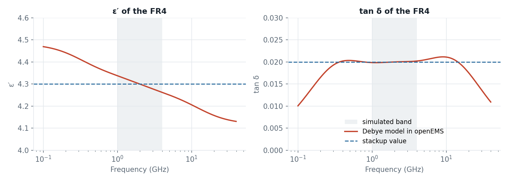
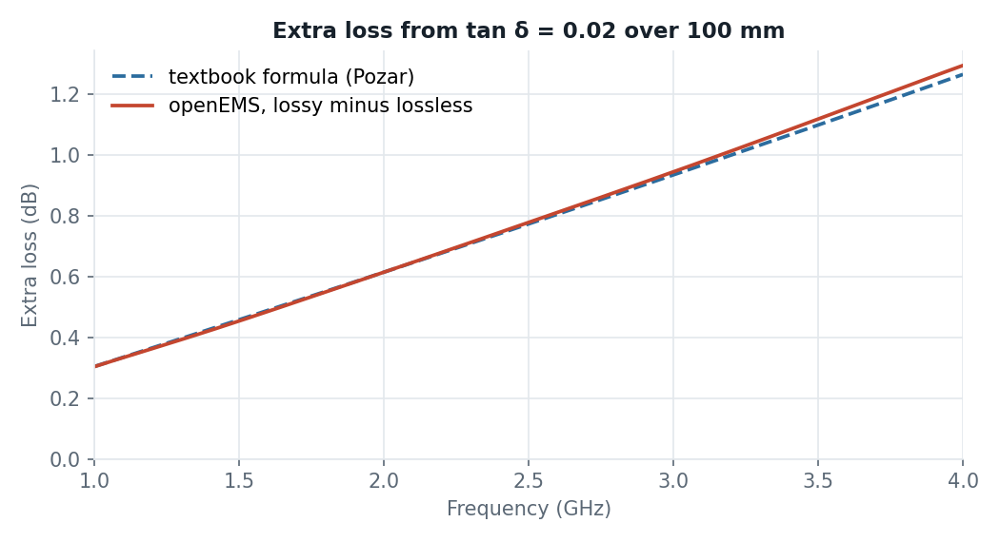

# Dielectric loss tangent in openEMS: microstrip test

So far, gds2openEMS ignores `DielectricLossTangent` in the stackup file: all dielectrics are simulated without loss. This example tests a prepared implementation that adds the loss tangent to the openEMS model. It is based on [PR #52](https://github.com/VolkerMuehlhaus/gds2openEMS/pull/52) by EngGhaith, with one fix in the material fit.

The test case is a textbook microstrip line on FR4, simulated with and without loss tangent and compared with the textbook formula for dielectric loss.

## Key facts

- The extra loss from the loss tangent matches the textbook formula **within −1 % to +2 %**.
- The permittivity stays right: the line's electrical length changes by less than 1 % when the loss tangent is switched on.
- On the CPU, a lossy dielectric makes the simulation **7× to 30× slower**. On the GPU, it is only about **3× slower**. Use the GPU engine for models with loss tangent.

## How openEMS models a loss tangent

openEMS simulates in the time domain. A loss tangent that is constant over frequency has no direct equivalent there. Instead, the dielectric is described as a sum of relaxation terms (a Debye model), fitted so that ε′ and tan δ match the stackup values over the simulated band, `fstart` to `fstop`.

A real dielectric with a constant loss tangent cannot have a perfectly constant ε′: physics (the Kramers-Kronig relations) ties the two together, so ε′ must fall slowly with frequency. The fitted model shows exactly that:

- Inside the simulated band (grey), tan δ stays at 0.02, and ε′ stays within ±0.9 % of 4.3.
- Outside the band, the model drifts away from the stackup values. That does not matter, because the simulation has no energy there.

## Step 1: Does the loss come out right?

The line is 100 mm long, 50 Ω, on 1.6 mm FR4 with εr = 4.3 and tan δ = 0.02, simulated from 1 to 4 GHz. It runs twice: once with tan δ = 0, once with tan δ = 0.02. The difference in |S21| is the loss caused by the loss tangent alone; the copper loss is the same in both runs and cancels out.

The simulated extra loss grows from 0.30 dB at 1 GHz to 1.30 dB at 4 GHz. It agrees with the textbook formula for microstrip dielectric loss (Pozar, *Microwave Engineering*) within −1 % to +2 %.

## Step 2: Does the permittivity stay right?

A loss model should add loss without changing the line's electrical length. From the phase of S21, the effective permittivity of the lossy line differs from the lossless one by at most ±0.8 %. That is exactly the small ε′ ripple of the fitted model shown above, so openEMS reproduces the fitted material faithfully.

The group delay of the lossy line is about 0.7 % shorter. This is not an error: it follows from the slowly falling ε′ that a constant loss tangent requires, and the fitted model predicts the same value. A real FR4 line shows the same effect.

## Step 3: What does it cost in run time?

openEMS computes the Debye material on the CPU with a single thread only. A lossy dielectric therefore slows the CPU engine down a lot. The GPU engine computes it on the GPU, at much less cost:

| Machine | CPU, lossless | CPU, lossy | GPU, lossless | GPU, lossy |
|---|---|---|---|---|
| hpz2 (Ryzen AI Max+ 395, Radeon 8060S) | 3.9 s | 27 s | 0.5 s | 1.3 s |
| Windows laptop (Ryzen 7 5800H, RTX 3060 Laptop) | 12 s | 364 s | 0.9 s | 3.0 s |

- On the CPU, the lossy line takes 7× (hpz2) to 30× (laptop) as long as the lossless one.
- On the GPU, it takes about 3× as long.
- For the lossy line, the GPU was 21× (hpz2) and 120× (laptop) faster than the CPU.

CPU and GPU give the same results.

## Using it

The implementation is prepared, but not yet part of gds2openEMS. The plan:

- The loss tangent stays off by default, because of the CPU run time. A setting will switch it on.
- The fit uses `settings['fstart']` and `settings['fstop']` of the model. Inside that band, the loss tangent is reproduced; outside, it is not.
- With the loss tangent switched on, run the model on the GPU (`settings['engine'] = 'gpu'`).

## Model details

| Item | Value |
|---|---|
| Substrate | FR4, εr = 4.3, tan δ = 0.02, 1.6 mm |
| Conductors | copper, 35 µm, σ = 5.8e7 S/m (ground plane and strip) |
| Line | 100 mm long, 3.11 mm wide (50 Ω from the Hammerstad formulas, see `results/microstrip_design.py`) |
| Ports | via ports from ground to strip at both ends, port 1 excited |
| Band | 1–4 GHz |
| Mesh | 0.11 M cells, 200 µm at the strip edges, PEC boundaries |
| End criterion | −40 dB |
| Debye fit | 5 relaxation terms (default of the fit, 4 per decade) |

The textbook formula is Pozar's microstrip dielectric attenuation, α_d = k₀·εr·(ε_eff − 1)·tan δ / (2·√ε_eff·(εr − 1)), with ε_eff taken from the phase of the lossless simulation.

Files:

- `FR4_microstrip_lossless.xml`, `FR4_microstrip_lossy.xml`: the two stackups, identical except for `DielectricLossTangent`.
- `run_microstrip_attenuation.py lossless|lossy`: builds and runs the model, writes `results/sparams_<variant>.npz` and a `.s2p` file.
- `results/microstrip_design.py`: the line width from the textbook formulas.
- `results/plot_comparison.py`: makes the two plots from the `.npz` files.

## Test details

| | hpz2 | Windows laptop |
|---|---|---|
| CPU | AMD Ryzen AI Max+ PRO 395, 16 cores | AMD Ryzen 7 5800H, 8 cores |
| GPU | AMD Radeon 8060S, built-in, HIP | NVIDIA RTX 3060 Laptop, 6 GB, HIP |
| OS | Linux | Windows 11 |
| openEMS | v0.37.0-33-g53a4264 | v0.37.0-38-gd686f1d (Windows test package) |
| CPU threads chosen by openEMS, lossy | 3 | not recorded |
| Timesteps, lossless / lossy | 18,791 / 18,829 | 18,791 / 18,829 (CPU lossy: 18,278) |

The plotted results are from the GPU runs on hpz2. The laptop's GPU runs gave the same S-parameters; its CPU run of the lossy line deviated by up to 0.04 dB, because it stopped at a slightly different timestep.
